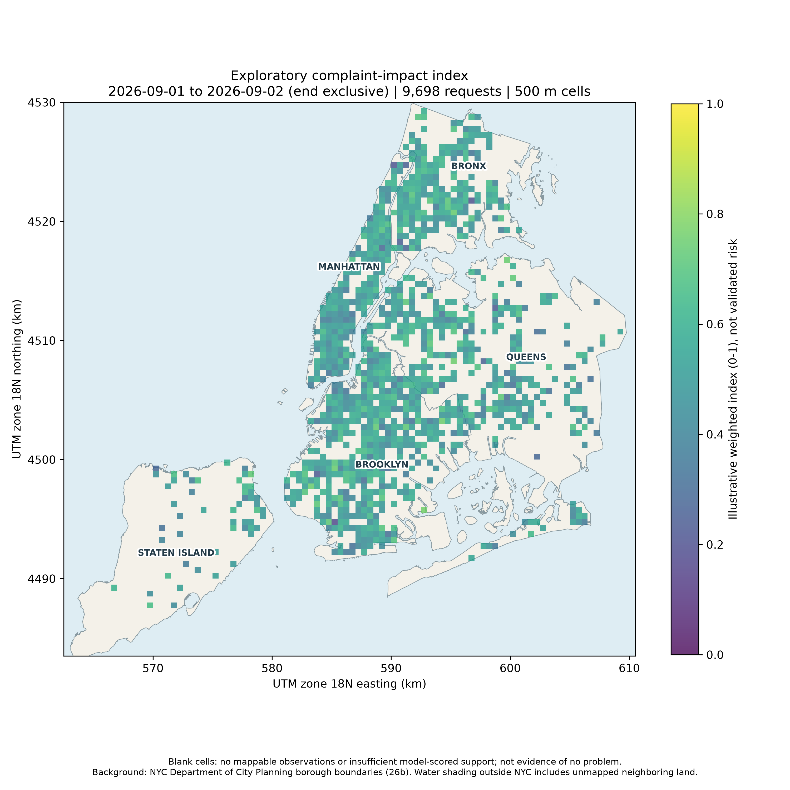
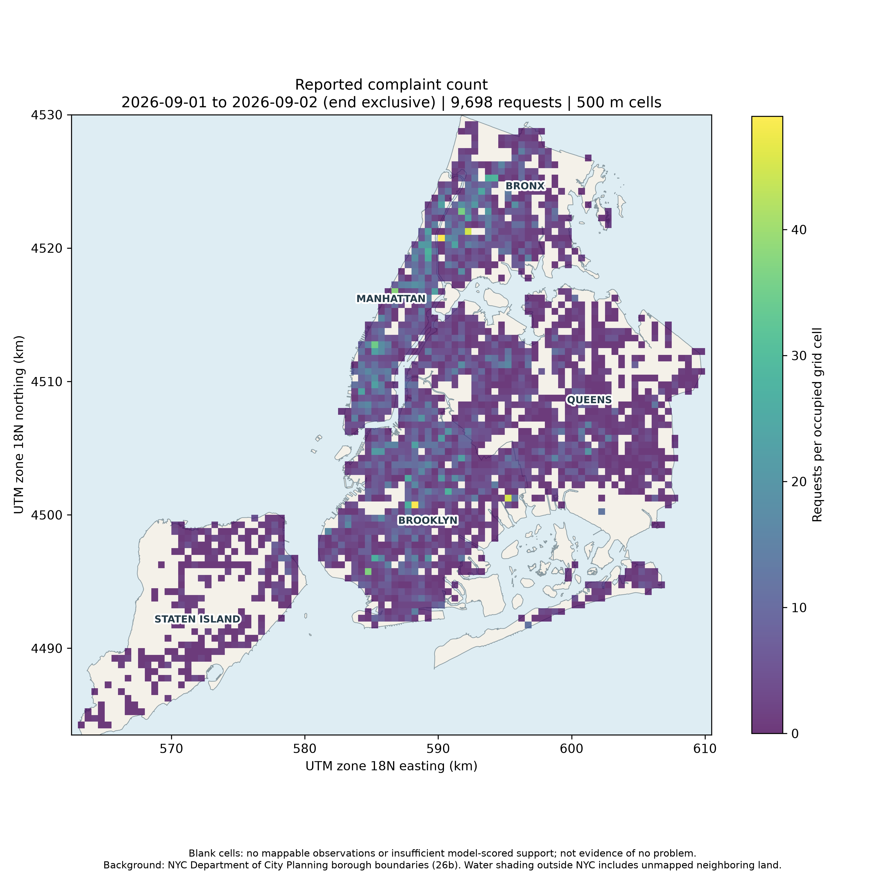
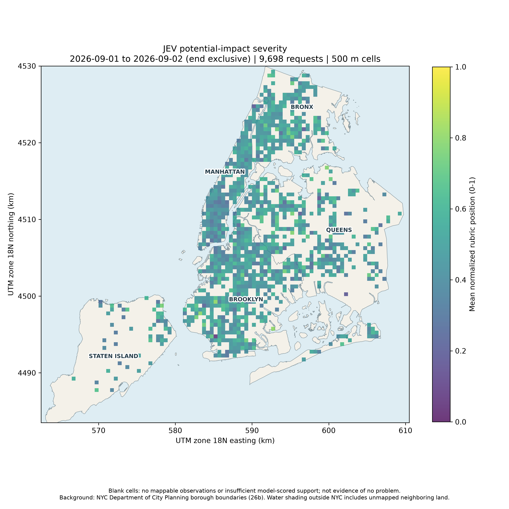
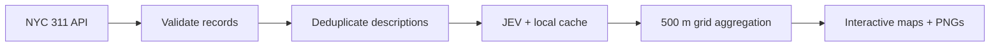

<div align="center">

# NYC 311 · JEV Heatmaps

**From reported conditions to explorable city-scale signals.**

A research demonstration by **CompleteTech LLC AI Research**  
Python · TypeSafe JEV · NYC Open Data · Folium

[Explore results](#a-day-in-new-york) · [Get started](#1-install) · [Methodology](#aggregation-and-formulas) · [Verification](TESTING.md)

</div>

---



Download a bounded slice of NYC 311 reports, evaluate complaint descriptions with JEV, and map the resulting signals on a projected geographic grid. The pipeline caches repeated descriptions, validates model responses, and produces interactive HTML maps and print-ready PNGs.

> **Research context:** These maps show reported complaints and model-estimated potential impact. They do not measure verified hazards, actual harm probabilities, or population-adjusted safety risk. Blank cells are not evidence of no problem.

## A day in New York

**September 1, 2026 · All boroughs · 500-meter cells · JEV `jev-1.13.0`**

| Reports downloaded | Reports mapped | Occupied cells | Distinct descriptions |
| ---: | ---: | ---: | ---: |
| 9,903 | 9,698 | 2,043 | 634 |

The live run excluded 205 reports with missing or invalid coordinates, completed **634 API calls without retries**, and reported **539,979 input tokens**. Repeated descriptions share one evaluation.

<table>
<tr>
<td width="50%"><a href="results/2026-09-01/raw_count.png"></a><br/><strong>Reporting volume</strong><br/>Where mappable complaints were recorded.</td>
<td width="50%"><a href="results/2026-09-01/severity_mean.png"></a><br/><strong>Potential-impact severity</strong><br/>Mean normalized position on the JEV rubric.</td>
</tr>
</table>

| Layer | What it shows | Preview |
| --- | --- | --- |
| Complaint count | Reports per occupied cell | [PNG](results/2026-09-01/raw_count.png) |
| Scoring coverage | Fraction of reports with a model score | [PNG](results/2026-09-01/scored_fraction.png) |
| Severity | Mean normalized potential-impact severity | [PNG](results/2026-09-01/severity_mean.png) |
| Safety concern | Mean model probability of the defined hazard proposition | [PNG](results/2026-09-01/safety_mean.png) |
| Answer ambiguity | Mean per-report ambiguity proxy | [PNG](results/2026-09-01/uncertainty_mean.png) |
| Composite | Illustrative severity, concern, and volume index | [PNG](results/2026-09-01/composite.png) |

[All result files](results/2026-09-01/) · [Run metadata and source provenance](results/2026-09-01/run_metadata.json)

### Geographic backgrounds

Published PNGs include NYC borough shorelines, land/water shading, and borough labels. Background geometry comes from [NYC Department of City Planning, release 26b](https://data.cityofnewyork.us/City-Government/Borough-Boundaries/gthc-hcne). These are geographic reference backgrounds, not street tiles; neighboring land outside NYC is not represented. Interactive HTML retains its OpenStreetMap street basemap.

Download the boundary file locally (it is excluded from Git):

```powershell
python -c "import requests,pathlib; r=requests.get('https://data.cityofnewyork.us/resource/gthc-hcne.geojson',timeout=60); r.raise_for_status(); pathlib.Path('data').mkdir(exist_ok=True); pathlib.Path('data/nyc_borough_boundaries.geojson').write_text(r.text,encoding='utf-8')"
```

Add `--background-geojson data/nyc_borough_boundaries.geojson` when generating heatmaps. Existing cached scores can be reused with `--max-api-calls 0`.

### Open the interactive maps

From the repository directory, run:

```powershell
python -m http.server 8765 --bind 127.0.0.1 --directory results
```

Visit **http://127.0.0.1:8765/2026-09-01/index.html**. Serve HTML over localhost rather than opening it as a file, so tile requests include a web referrer. Interactive maps require internet access; PNG previews work directly on GitHub.

### What is published

This repository contains code, tests, six rendered map/PNG pairs, and run provenance. Interactive HTML includes **aggregate grid results**. Raw NYC records, per-request scored records, standalone CSV/GeoJSON exports, SQLite caches, and credentials remain local.

### Reproduce the published run

After installing dependencies below, copy `.env.example` to `.env` and add your own TypeSafe key. Then:

```powershell
python download_dataset.py --start 2026-09-01 --end 2026-09-02 --output data/nyc311_2026-09-01.csv
python generate_heatmap.py --input data/nyc311_2026-09-01.csv --dry-run
python generate_heatmap.py --input data/nyc311_2026-09-01.csv --max-api-calls 800 --output-dir output/jev_2026-09-01
```

Live inference incurs service usage. Source records can change and model responses can vary; reruns are not guaranteed byte-for-byte. The published metadata records the original query and input SHA-256.



---

## Files

- `download_dataset.py`: a standalone downloader. Its only third-party dependency is `requests`.
- `generate_heatmap.py`: direct TypeSafe HTTP integration, persistent SQLite cache, geographic aggregation, HTML maps and PNGs.
- `requirements.txt`: application dependencies.
- `tests/test_pipeline.py`: 32 offline tests. All test records and model responses are explicitly synthetic.
- `test_results.txt` and `TESTING.md`: test results and remaining live-validation limitations.
- `tested_versions.txt`: exact versions used for the offline tests.

No real API key or downloaded NYC dataset is included. Published results were generated with live JEV inference. The application has **no mock-scoring fallback**. Mocks exist only in the tests.

## 1. Install

Clone the repository, open its directory, and create a local environment:

```powershell
python -m venv .venv
.\.venv\Scripts\Activate.ps1
python -m pip install -r requirements.txt
```

On macOS/Linux, activate with `source .venv/bin/activate` instead. Use `python3` in place of `python` where appropriate. Activation is optional when calling the virtual environment's Python executable directly.

## 2. Download one complete day

```powershell
python download_dataset.py --start 2026-09-01 --end 2026-09-02 --output data/nyc311.csv
```

`--start` is inclusive and `--end` is exclusive. The example requests September 1, 2026, rather than both dates. The source uses floating timestamps; the script treats the date bounds as NYC local/source time and does not convert them to UTC.

Dataset: [NYC 311 Service Requests from 2020 to Present](https://data.cityofnewyork.us/d/erm2-nwe9)

API endpoint:

```text
https://data.cityofnewyork.us/resource/erm2-nwe9.json
```

For a larger slice limited to one borough:

```powershell
python download_dataset.py --start 2026-09-01 --end 2026-09-08 --borough BROOKLYN --max-rows 100000 --output data/brooklyn.csv
```

`--max-rows` defaults to 100,000. The script counts matching rows first and **stops rather than silently downloading only the earliest records** when the result exceeds that budget. Shorten the date range, select a borough, or explicitly raise the budget. It does not construct a statistically representative random sample.

`--page-size` defaults to 5,000. The downloader uses ordered keyset pagination by `(created_date, unique_key)`, retries transient GET failures, and writes a temporary file before replacing a completed CSV. Existing outputs require `--force` to replace them. Downloading itself is not resumable; model scoring is.

Outputs:

```text
data/nyc311.csv
data/nyc311.csv.metadata.json
```

The metadata includes the source query, dates, row counts, retrieval times, and CSV SHA-256. The live API does not provide an atomic snapshot: records can change while pages are fetched. The script flags a count mismatch, but matching counts cannot prove that no source edits occurred.

An optional Socrata app token can be set locally:

```powershell
$env:SOCRATA_APP_TOKEN = "YOUR_OPTIONAL_SOCRATA_APP_TOKEN"
```

The downloader never requests addresses, names, or free-form resolution descriptions. It does retain public latitude/longitude fields for local mapping. Preserve the dataset's applicable usage terms when redistributing downloaded data.

## 3. Run a no-key baseline

```powershell
python generate_heatmap.py --input data/nyc311.csv --mode baseline --output-dir output/baseline
```

Open `output/baseline/index.html`. This mode generates a complaint-count grid map and PNG without calling JEV, without reading a TypeSafe key, and without generating synthetic severity or safety values.

## 4. Inspect the inference workload

```powershell
python generate_heatmap.py --input data/nyc311.csv --dry-run
```

This validates the input and reports mappable requests, unique descriptive states, cache hits, and the minimum number of new API calls. It does not call JEV or render maps. It may create the local empty cache database.

An individual API request asks all three questions for one descriptive state. It is **not** a batch of multiple incident records. Records with exactly the same normalized descriptive fields reuse one cached evaluation.

## 5. Supply your TypeSafe key and generate JEV heatmaps

Get a key from the [TypeSafe dashboard](https://console.typesafe.ai). Add it to a local `.env` beside `generate_heatmap.py` (this file is ignored by Git):

```dotenv
TYPESAFE_API_KEY=YOUR_TYPESAFE_API_KEY
```

Live JEV runs automatically load this file regardless of your working directory. Existing environment variables take precedence. Baseline and dry runs do not load it. Keep the real `.env` private and exclude it from shared ZIPs.

Alternatively, set the key in your shell environment:

PowerShell:

```powershell
$env:TYPESAFE_API_KEY = "YOUR_TYPESAFE_API_KEY"
```

macOS/Linux:

```bash
export TYPESAFE_API_KEY="YOUR_TYPESAFE_API_KEY"
```

Then run:

```powershell
python generate_heatmap.py --input data/nyc311.csv --mode jev --model jev-1.13.0 --max-api-calls 2000 --cell-m 500 --output-dir output/jev
```

Serve the maps over localhost so browser tile requests include the referrer required by OpenStreetMap:

```powershell
.\serve_maps.ps1
```

Open `http://127.0.0.1:8765/jev/index.html` for the default output, or select your dated output folder at `http://127.0.0.1:8765/`. Keep the server running while browsing. Opening interactive HTML directly as a local file can produce "Access blocked" background tiles. PNGs still open directly.

`--max-api-calls` is a hard limit on HTTP attempts **per invocation, including retries**. Its default is 500; the example explicitly allows 2,000. A dry run gives the minimum number of new calls; retries can require additional attempts. When the uncached-state count exceeds the cap, the script stops before making any calls. When retries exhaust the cap mid-run, completed evaluations remain cached and the run stops rather than producing partially scored maps.

The script sends these descriptive fields to TypeSafe:

```text
complaint_type, descriptor, location_type, agency
```

Coordinates, boroughs, request IDs, dates, statuses, and closed/resolution information are not included in the JEV state. This example evaluates the condition **if it exists as described**, not its current status or whether the complaint has been verified.

The JEV integration uses the documented endpoint and three independent questions:

```python
body = {
    "model": "jev-1.13.0",
    "state": semantic_state(row),
    "questions": QUESTIONS,
}
response = session.post(
    "https://api.typesafe.ai/v1/systemone",
    json=body,
    timeout=(15, 60),
    allow_redirects=False,
)
```

`QUESTIONS` in `generate_heatmap.py` is the complete editable rubric:

- `severity`: a five-level `Score`, zero-based 0 through 4.
- `safety_concern`: a `Noul` representing the model's probability that the described condition presents the defined plausible physical hazard, conditional on it existing as described.
- `category`: a `Choice` among infrastructure, sanitation, noise, housing, traffic, environment and other.

The script parses the nested `answers` object, validates types/ranges and category distributions, records the resolved model, and preserves raw responses in SQLite.

## 6. Outputs

The default JEV run generates six map/PNG pairs, provided the semantic layers have enough supporting observations:

| Filename stem | Meaning |
| --- | --- |
| `raw_count` | Count of mappable requests per occupied cell; linear color scale. |
| `scored_fraction` | Fraction of mappable requests in a cell with a model score. |
| `severity_mean` | Average normalized JEV severity. |
| `safety_mean` | Average JEV safety-concern proposition probability. |
| `uncertainty_mean` | Average per-request answer-ambiguity proxy, defined below. |
| `composite` | Illustrative weighted complaint-impact index, defined below. |

Every generated stem produces `.html` and `.png`. PNGs use a 10-by-10-inch figure at 300 DPI by default: 3,000 by 3,000 pixels. Each metric has its own figure. HTML maps have a basemap, metric legend and cell tooltips. Use `index.html` as the entry point because it includes interpretation warnings and run context.

The output directory also contains:

```text
index.html
requests_used.csv
grid.csv
grid.geojson
run_metadata.json
```

`requests_used.csv` includes the validated/mappable requests, model features in JEV mode, and cache keys. `grid.csv` and `grid.geojson` contain **all occupied cells**, including values suppressed from semantic display. Metadata records the input hash, data-quality exclusions, question rubric, model identifiers, cell size, usage reported for successful new calls, and limitations. Reported token usage is not a complete billing record: failed/timed-out calls may have incurred charges.

Add category maps:

```powershell
python generate_heatmap.py --input data/nyc311.csv --category-maps --max-api-calls 2000 --output-dir output/jev_categories
```

This adds seven maps whose intensity is the sum of each category's probabilities in a cell. These are **fractional model-implied complaint masses**, not hard category counts or measured incidence. Their totals sum to the number of scored requests, apart from floating-point rounding. Each category mass map scales to its own maximum; use the legends/grid export instead of comparing colors across categories as though they share an absolute scale.

## Aggregation and formulas

Latitude/longitude is projected to UTM zone 18N (`EPSG:32618`) before allocating square cells. `--cell-m 500` specifies 500-meter projected cells, not 500-degree cells or Web Mercator pixels. PNG axes are UTM kilometers. GeoJSON geometry is transformed back to longitude/latitude.

For a cell, the illustrative composite is:

```python
severity_mean = mean(severity_raw / 4.0)
safety_mean = mean(safety_probability)
volume_normalized = log1p(cell_request_count) / log1p(max_cell_request_count)
composite = 0.50 * severity_mean + 0.30 * safety_mean + 0.20 * volume_normalized
```

The 50/30/20 weights are design choices, not a fitted or validated public-safety model. Volume normalization is relative to the current input slice; separately normalized runs are not automatically longitudinally comparable. Keep the grid, population/time denominators, scales, and rubrics consistent for a formal comparison.

Per-request ambiguity is:

```python
ambiguity = (
    (1.0 - severity_confidence)
    + (1.0 - category_confidence)
    + 4.0 * safety_probability * (1.0 - safety_probability)
) / 3.0
```

The last term is normalized Bernoulli variance, highest at `p = 0.5`. A cell displays the **mean of individual ambiguity values**, not ambiguity computed from the cell-average probability. The proxy combines distribution-concentration measures; it is not a calibrated probability of model error, a confidence interval, or a complete account of missing evidence. JEV's confidence values do not establish domain calibration by themselves.

By default a semantic cell needs at least 3 scored requests and 90% scoring coverage. These are illustrative display thresholds. Cells below them are omitted from semantic maps, not assigned a misleading zero. Counts and coverage remain visible. Change with `--min-count` and `--min-coverage`. Repeated identical descriptions count as requests, but are not independent model evaluations.

## Cache, reruns and failure handling

Cached evaluations are keyed by the complete state, model ID, questions/rubrics, and adapter schema version. Changing a rubric or model generates different keys. Changing only the grid size, DPI or display threshold does not require new inference.

For example, regenerate coarser maps using only cached evaluations:

```powershell
python generate_heatmap.py --input data/nyc311.csv --cell-m 1000 --max-api-calls 0 --output-dir output/jev_1km
```

This succeeds only when every needed descriptive state is cached. An interrupted scoring run resumes from the same cache on the next invocation. Existing output directories require `--overwrite` to replace generated files; unrelated files are not removed. Old layers not generated by the new run may remain in that folder, so use the new index/metadata or choose a fresh output directory.

`--model jev-1.13.0` is the default pinned version, verified in the TypeSafe documentation on September 19, 2026. A different available model can be supplied with `--model`. Moving aliases such as `jev-latest` are supported but cached entries expire after 24 hours by default (`--alias-cache-hours`). The code rejects runs that would mix different resolved model versions. Prefer pinned versions for reproducibility.

Requests are sequential, defaulting to at most 4 attempts per second. Transient errors receive bounded backoff and `Retry-After` handling. Authentication/contract errors stop immediately. Timeouts and retries can incur duplicate service charges because this example does not claim server-side idempotency. `--max-attempts` defaults to 3 per state and remains bounded by the global attempt limit.

JEV failures never fall back to random, keyword-derived, zero-valued or simulated scores. To make a no-key map, explicitly select `--mode baseline`.

## Interpretation and data-quality limitations

The downloader retrieves reports, not ground-truth labels. The visualization retains reports regardless of open/closed status because the model estimates intrinsic potential impact from descriptions; a September 1 complaint should not be interpreted as a hazard still present today.

311 reporting volume can vary with reporting behavior and access. Count layers are not normalized by population, infrastructure exposure or reporting propensity. A sparse location may have fewer reports, missing coordinates, or limited reporting rather than fewer underlying problems. These signals are for an exploratory software demonstration, not emergency dispatch or decisions about individual residents.

Invalid/missing coordinates, missing IDs and duplicate IDs are recorded as exclusions. The broad extent check is not an official NYC boundary polygon. The exported download metadata must match the CSV hash; editing the CSV invalidates that metadata until it is deliberately removed or replaced with correct provenance.

Interactive HTML depends on externally hosted JavaScript/CSS and OpenStreetMap tiles. Those maps need an internet connection and contact third-party asset/tile servers. PNGs, CSV, GeoJSON and the index text can be used offline. Opening maps does not call JEV. The map HTML contains aggregate cell information, not the per-request descriptive state or your API key.

## Testing

```powershell
python -m unittest discover -s tests -v
```

**32 offline tests passed** on September 19, 2026, using synthetic records and mocked service responses. Tested paths include ordered pagination, budget refusal, cleanup after failure, response parsing, cache reuse, credential failure, retry limits, coordinate filtering, aggregation, support thresholds, and PNG/HTML generation.

The published results also completed a live NYC download and 634 live JEV evaluations on Windows. These checks establish integration behavior, not model accuracy or calibration. See [verification details](TESTING.md).

## Primary documentation

Documentation checked September 19, 2026:

- Dataset: https://data.cityofnewyork.us/d/erm2-nwe9
- NYC dataset split and column-label changes: https://www.nyc.gov/opendata/news/all-news/311-Service-Requests-Updates
- TypeSafe HTTP API: https://docs.typesafe.ai/api
- TypeSafe quickstart: https://docs.typesafe.ai/introduction/quickstart
- TypeSafe model identifiers: https://docs.typesafe.ai/models
- TypeSafe confidence interpretation: https://docs.typesafe.ai/confidence
- TypeSafe composite-scoring pattern: https://docs.typesafe.ai/patterns/composite-scoring
- Socrata limits: https://dev.socrata.com/docs/queries/limit.html
- Socrata ordered pagination: https://dev.socrata.com/docs/queries/order.html
- Socrata floating timestamps: https://dev.socrata.com/docs/datatypes/floating_timestamp.html
- Folium GeoJSON: https://python-visualization.github.io/folium/latest/user_guide/geojson/geojson.html
